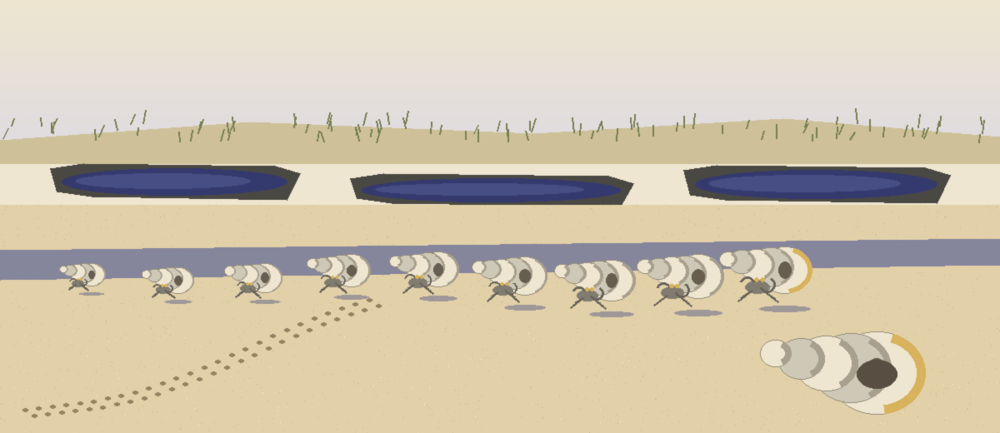
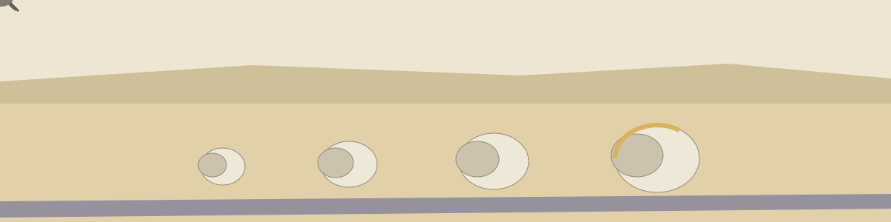

# Zenyx-Markdown-Reader



# Zenyx-Markdown-Reader

An open-source ReadMe!-style alternative: a lightweight Markdown reader and
renderer. Point it at a README (or any Markdown file) and read it comfortably
in the terminal, or turn it into a standalone HTML page. Standard library
only, nothing to install.

## Usage

```sh
python3 zenyx.py README.md                 # read in the terminal (ANSI colors on a TTY)
python3 zenyx.py README.md --plain         # terminal text without colors
python3 zenyx.py README.md --html          # standalone HTML page to stdout
python3 zenyx.py README.md --html -o page.html
cat README.md | python3 zenyx.py -         # read from stdin
```


## Supported Markdown

- ATX headings (`#` to `######`)
- Bold, italic, strikethrough, inline code
- Fenced code blocks (contents are never reformatted)
- Links and images
- Unordered and ordered lists (an ordered list keeps its starting number)
- Blockquotes
- Horizontal rules
- Pipe tables (rendered as aligned text in the terminal, real `<table>` in HTML)

In HTML output, link and image destinations are checked against a scheme
allowlist (`http`, `https`, `mailto`, plus relative paths and `#anchors`).
A destination with any other scheme, such as `javascript:` or `data:`, is
replaced with `#`, so a Markdown file from someone else cannot plant a
clickable script in a page I render from it. The check reads the scheme
the way a browser does: leading spaces and control characters are
stripped first, and tab, carriage return, and newline characters inside
the destination are removed before the scheme is read, so a scheme
spelled with a tab inside it is still caught.

A file that is missing, is a directory, or is not valid UTF-8 text gets
a short error on stderr and exit 2. Nothing here prints a traceback for
input I cannot read.


## Library use

```python
from zenyx import render

text = render(open("README.md").read(), "plain")   # or "ansi" / "html"
print(text)
```

`render()` raises `ValueError` for any other mode name, instead of
quietly returning plain text for a name it does not know.


## Tests

```sh
python3 -m unittest
```

22 tests in `test_zenyx.py`: the URL scheme allowlist (allowed and
blocked schemes, padded schemes, and schemes with a tab, carriage
return, or newline inside the word), HTML and plain rendering of the
constructs listed above, escaping of raw HTML in the source, the
unknown mode error, and the command line paths (missing file, non-UTF-8
file, directory, stdin, and writing an HTML file with `-o`).

## License

MIT (see LICENSE).

> Shell note, the honest limits: code spans written with double backticks are cut at the first inner backtick, a link destination containing a closing parenthesis is cut short at that character, and the double underscore form of bold can still trigger in the middle of a word even though the italic patterns guard against it. These limits are admitted in the code comments of `zenyx.py` and are stated here rather than buried.
