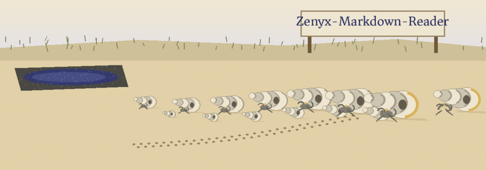

# Zenyx-Markdown-Reader

An open-source ReadMe!-style alternative: a lightweight Markdown reader and
renderer. Point it at a README (or any Markdown file) and read it comfortably
in the terminal, or turn it into a standalone HTML page. Standard library
only, nothing to install.

## Usage

```sh
python3 zenyx.py README.md                 # read in the terminal (ANSI colors on a TTY)
python3 zenyx.py README.md --plain         # terminal text without colors
python3 zenyx.py README.md --html          # standalone HTML page to stdout
python3 zenyx.py README.md --html -o page.html
cat README.md | python3 zenyx.py -         # read from stdin
```

## Supported Markdown

- ATX headings (`#` to `######`)
- Bold, italic, strikethrough, inline code
- Fenced code blocks (contents are never reformatted)
- Links and images
- Unordered and ordered lists (an ordered list keeps its starting number)
- Blockquotes
- Horizontal rules
- Pipe tables (rendered as aligned text in the terminal, real `<table>` in HTML)

In HTML output, link and image destinations are checked against a scheme
allowlist (`http`, `https`, `mailto`, plus relative paths and `#anchors`).
A destination with any other scheme, such as `javascript:` or `data:`, is
replaced with `#`, so a Markdown file from someone else cannot plant a
clickable script in a page I render from it.

## Library use

```python
from zenyx import render

text = render(open("README.md").read(), "plain")   # or "ansi" / "html"
print(text)
```

## License

MIT (see LICENSE).
